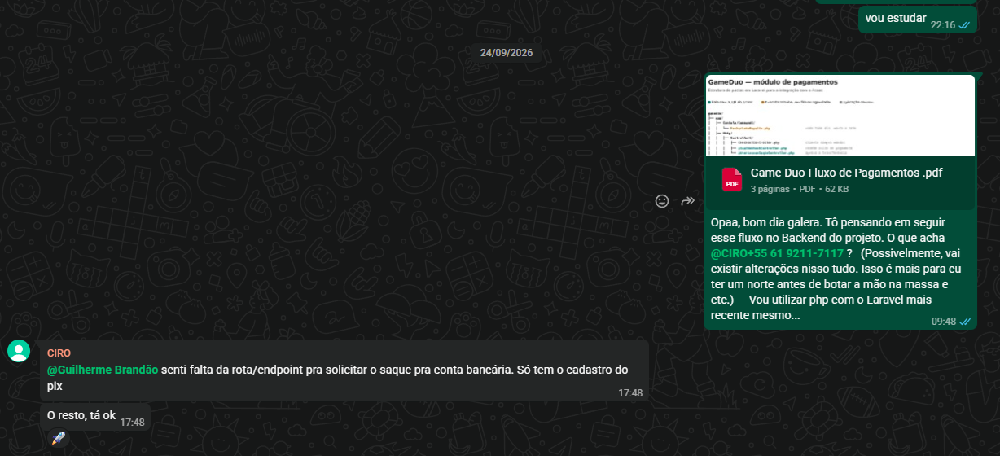
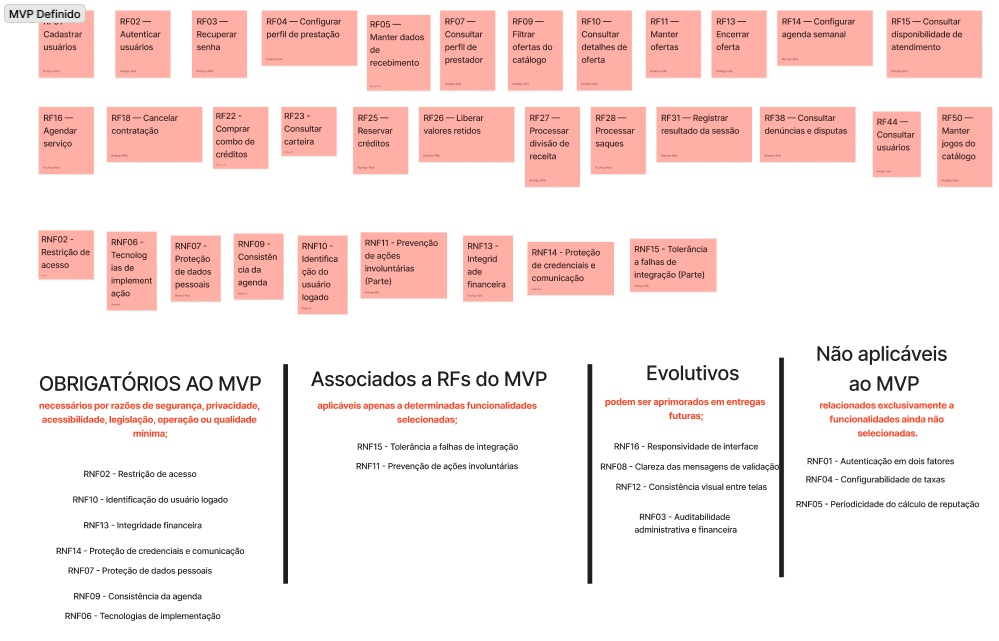

# Evidências

Registro das evidências do GameDuo, marketplace de coaching e duo remunerado desenvolvido pela equipe GoHorse na disciplina de Requisitos de Software da UnB/FCTE, turma T02, semestre 2026.2. A organização acompanha as iterações do OpenUP e as validações quinzenais com Ciro Vargas, cliente, idealizador e único tomador de decisão.

As decisões abaixo representam o momento de cada reunião. Para as especificações atuais, consultar a [seção 8 — Requisitos de Software](requisitos-software.md); para o processo de aceite, consultar a [seção 7 — Interação entre Equipe e Cliente](interacao-equipe.md).

## Índice

| Iteração | Fase | Período | Reuniões e evidências |
| --- | --- | --- | --- |
| [1](#iteracao-1) | Iniciação | 11/08/2026 a 31/08/2026 | Escolha do projeto |
| [2](#iteracao-2) | Iniciação | 01/09/2026 a 08/09/2026 | [Reunião 1 — Características de Produto](#reuniao-1) |
| [3](#iteracao-3) | Elaboração | 09/09/2026 a 22/09/2026 | [Reunião 2 — Fluxograma completo](#reuniao-2); [Validação dos requisitos com o monitor](#validacao-monitor) |
| [4](#iteracao-4) | Elaboração | 23/09/2026 a 06/10/2026 | [Validação do fluxo de pagamentos](#validacao-pagamentos); [Reunião 3 — MoSCoW](#reuniao-3); [Reunião 4 — Matriz 4x4 e MVP da equipe](#reuniao-4) |
| [5](#iteracao-5) | Elaboração | 07/10/2026 a 13/10/2026 | [Reunião 5 — Validação do MVP](#reuniao-5) |
| [6](#iteracao-6) | Construção | 14/10/2026 a 27/10/2026 | Planejada |
| [7](#iteracao-7) | Construção | 28/10/2026 a 10/11/2026 | Planejada |
| [8](#iteracao-8) | Construção | 11/11/2026 a 17/11/2026 | Planejada |
| [9](#iteracao-9) | Construção | 18/11/2026 a 01/12/2026 | Planejada |
| [10](#iteracao-10) | Transição | 02/12/2026 a 10/12/2026 | Planejada |

!!! note "Fontes e limites do registro"
    Os PDFs das reuniões 1, 2 e 3 foram lidos integralmente: 17, 34 e 24 páginas, respectivamente. São transcrições automáticas, sujeitas a erros. Falas ambíguas não foram convertidas em decisões definitivas. A presença foi identificada pelas falas registradas, sem pressupor a participação de toda a equipe. Os períodos das iterações seguem o cronograma informado para esta página.

## Iteração 1 — Iniciação {#iteracao-1}

**Período:** 11/08/2026 a 31/08/2026.

**Atividade registrada:** escolha do GameDuo como projeto da equipe. Não foi fornecida ata específica dessa escolha; não há reunião individualizada a detalhar nesta iteração.

## Iteração 2 — Iniciação {#iteracao-2}

**Período:** 01/09/2026 a 08/09/2026.

### Reunião 1 — Cliente: validação das Características de Produto {#reuniao-1}

**Data:** 03/09/2026, às 19h16 (UTC−03:00; o PDF registra 22h16 UTC).  
**Participantes identificados:** Ciro Vargas, Pedro Araujo Lucena e Ricardo Lucas.  
**Objetivo:** revisar as Características de Produto, esclarecer o funcionamento dos pagamentos e alinhar a comunicação com o cliente.

!!! abstract "Resumo"
    Foram discutidos pagamentos com divisão de receita, dados bancários dos prestadores, disponibilidade de saldo e solicitação de saque. A revisão incluiu avaliações, administração, acompanhamento das sessões e venda de guias e tutoriais. Integrações com plataformas de jogos foram sugeridas para apoiar a apresentação de credenciais. Ao final, Pedro e Ricardo organizaram ajustes na documentação após a saída do cliente.

!!! success "Decisões"
    - Incluir guias e tutoriais pagos e detalhar a administração, inclusive o cadastro dos jogos disponíveis.
    - Prever cadastro bancário, solicitação de saque e apresentação dos serviços prestados, ganhos e disponibilidade do saldo para o prestador.
    - Manter a escolha do gateway aberta à equipe; Ciro se dispôs a enviar documentação de referência sobre split. O exemplo de 30% para a plataforma e 70% para o prestador não define uma taxa imutável.
    - Caso haja armazenamento de cartão para compras futuras, utilizar o gateway para essa finalidade.
    - Adotar reuniões a cada 15 dias e comunicação pontual por WhatsApp ou Discord. Ciro informou disponibilidade entre 13h e 14h e após 18h.
    - Manter liberdade de escolha tecnológica. Ciro ofereceu apoio técnico caso a equipe adotasse PHP e React; a conversa interna posterior indicou preferência por essas tecnologias.

!!! warning "Pontos em aberto"
    - Selecionar o gateway e estudar split, prazos de disponibilidade, saque e integração.
    - Investigar a viabilidade das APIs de jogos e das informações de perfil sugeridas.
    - Refinar as Características de Produto e validar a estratégia tecnológica com a equipe.
    - Torneios e desafios pagos foram ideias de evolução; a equipe indicou dificuldade de incluí-los no MVP, sem assumir compromisso de entrega.
    - A gravação começa durante a discussão de split. A parte anterior da conversa não pode ser reconstituída integralmente a partir deste PDF.

#### Vídeo

<iframe src="https://drive.google.com/file/d/1UH1ve2UZha2U-qVzk6gPEqmpTeKA1GZD/preview" title="Reunião 1 — Validação das Características de Produto" width="100%" style="aspect-ratio: 16 / 9; border: 0;" allow="autoplay; fullscreen" allowfullscreen loading="lazy"></iframe>

[Abrir no Google Drive](https://drive.google.com/file/d/1UH1ve2UZha2U-qVzk6gPEqmpTeKA1GZD/preview)

#### Artefatos

[Transcrição da Reunião 1 — Overview (PDF)](../Evidencias/Reuniao%2001%20-%20Evidencias%20-%20Overview.pdf). Evidências: pagamentos, pp. 1–2; características e integrações, pp. 3–6; tecnologias e comunicação, pp. 6–8; encaminhamentos internos, pp. 9–17.

## Iteração 3 — Elaboração {#iteracao-3}

**Período:** 09/09/2026 a 22/09/2026.

### Reunião 2 — Cliente: validação do fluxograma completo {#reuniao-2}

**Data:** 17/09/2026, às 19h18 (UTC−03:00).  
**Participantes identificados:** Ciro Vargas, Pedro Araujo Lucena, Ricardo Lucas e Leonardo Paiva, que ingressou durante a reunião e contribuiu com sugestões técnicas.  
**Objetivo:** validar o fluxograma completo que fundamentou o levantamento dos requisitos, identificando ajustes nas jornadas de consumidores, prestadores e administração.

!!! abstract "Resumo"
    A equipe percorreu cadastro, autenticação, catálogo, oferta de serviços, agenda, pagamentos, avaliação e moderação. O fluxograma representava a visão completa do produto, da qual ainda seria extraído o MVP. Ciro esclareceu o uso de uma conta única para consumir e prestar serviços, a reserva de horários e as regras de movimentação de saldo. Leonardo contribuiu com alternativas de antecipação financeira, referências para benchmarking e sugestões de privacidade nas avaliações.

!!! success "Decisões"
    - Manter o fluxo de cadastro e login apresentado. Uma mesma conta poderá contratar e prestar serviços, inclusive reutilizar o saldo recebido dentro da plataforma.
    - Substituir a negociação inicial de horários pela seleção de uma agenda semanal configurada pelo prestador. Recusa e reagendamento foram discutidos; a confirmação automática foi esclarecida posteriormente na Reunião 3.
    - Tornar o selo de verificação opcional e específico por jogo. A discussão encaminhou a ausência de restrições a prestadores sem selo e a possibilidade de filtrar por verificação.
    - Creditar a carteira após a confirmação do pagamento. Manter o valor na conta do consumidor até a prestação e prever liberação após 48 horas sem disputa, ou antes mediante confirmação do serviço. A disponibilidade para saque depende do gateway.
    - Parametrizar comissões pelo painel administrativo, com valor padrão e ajustes por modalidade e perfil. Preservar preço e comissão das contratações já realizadas.
    - Unificar a confirmação da sessão e a avaliação na interação com o usuário, permitindo informar que a sessão não ocorreu e justificar o motivo.
    - Permitir denúncias a qualquer momento e análise manual de disputas, com decisões financeiras e sanções registradas pela moderação.
    - Prever Ciro como administrador e moderador inicial e permissões para futuros funcionários.
    - Incorporar à visão do produto a possibilidade de o consumidor publicar uma solicitação de duo para prestadores disponíveis.
    - Encaminhar o fluxograma ajustado para validação assíncrona por WhatsApp.

!!! warning "Pontos em aberto"
    - Escolha do gateway, prazo de repasse e política de antecipação, incluindo quem absorveria suas taxas.
    - Política e percentual de penalidade por cancelamento: 50% foi questionado, 10% foi mencionado como alternativa e ficou acordada a parametrização administrativa, com pesquisa comparativa pendente.
    - Forma de comunicação durante o serviço e risco de contratações posteriores fora da plataforma. Não houve compromisso de construir comunicação própria.
    - A recomputação diária da reputação foi recomendada por Leonardo; Ciro discutiu alternativas de cálculo e publicação após avaliações de ambas as partes. A transcrição não contém um aceite inequívoco de uma periodicidade única.

#### Vídeo

<iframe src="https://drive.google.com/file/d/19kv2NZ-MmCV9_V8NVWMS4t6Ms5MJOU2k/preview" title="Reunião 2 — Validação do fluxograma completo" width="100%" style="aspect-ratio: 16 / 9; border: 0;" allow="autoplay; fullscreen" allowfullscreen loading="lazy"></iframe>

[Abrir no Google Drive](https://drive.google.com/file/d/19kv2NZ-MmCV9_V8NVWMS4t6Ms5MJOU2k/preview)

#### Artefatos

**Fluxograma completo — Figma**

[Figma no contexto do MVP](backlog-produto.md#1013-fluxograma-completo)

[Abrir no Figma](https://embed.figma.com/board/VFyXnt4X2cWQW8LYxHXFft/Sem-t%25C3%25ADtulo?node-id=0-1&p=f&embed-host=share)

[Transcrição da Reunião 2 — Fluxograma (PDF)](../Evidencias/Reuniao%2002%20-%20Evidencias%20-Fluxograma.pdf). Evidências: cadastro e agenda, pp. 1–6; pagamentos e cancelamento, pp. 7–17; moderação e conta única, pp. 18–25; comissões, avaliação e encaminhamentos, pp. 26–34.

### Validação dos requisitos com o monitor {#validacao-monitor}

**Data:** 19/09/2026.  
**Participantes:** equipe GoHorse e André (monitor da disciplina).  
**Objetivo:** revisar os requisitos funcionais e não funcionais com o monitor antes de sua publicação no GitPages.

!!! abstract "Resumo"
    A equipe apresentou ao monitor os requisitos levantados a partir do fluxograma validado na Reunião 2, para verificar a declaração e a classificação dos requisitos antes da publicação da seção de Requisitos de Software.

#### Vídeo

<iframe src="https://www.youtube.com/embed/p0EIO0XwIdA" title="Validação dos requisitos com o monitor" width="100%" style="aspect-ratio: 16 / 9; border: 0;" allow="accelerometer; autoplay; clipboard-write; encrypted-media; gyroscope; picture-in-picture; web-share" allowfullscreen loading="lazy"></iframe>

[Abrir no YouTube](https://youtu.be/p0EIO0XwIdA)

## Iteração 4 — Elaboração {#iteracao-4}

**Período:** 23/09/2026 a 06/10/2026.

### Validação assíncrona do fluxo de pagamentos {#validacao-pagamentos}

**Data:** 24/09/2026.  
**Participantes identificados:** Ciro Vargas e Guilherme Brandão, pelo WhatsApp.  
**Objetivo:** validar com o cliente o fluxo proposto para o módulo de pagamentos.

!!! abstract "Resumo"
    Guilherme apresentou o documento do fluxo de pagamentos para orientar a implementação do backend. Ciro analisou a proposta e apontou a ausência da rota para solicitar saque para conta bancária.

!!! success "Decisões"
    Ciro solicitou a inclusão da rota/endpoint de solicitação de saque, observando que o fluxo apresentado contemplava apenas o cadastro do Pix. Sobre o restante do fluxo, respondeu: “O resto, tá ok”.

!!! warning "Pontos em aberto"
    Vincular evidência de atendimento à solicitação de saque. O print registra o pedido e a concordância com o restante do fluxo, mas não comprova a implementação do ajuste.

#### Artefatos

[Abrir PDF do fluxo de pagamentos](../pdfs/Game-Duo%20Fluxo%20de%20Pagamentos-%20Aprovado%20Pelo%20Ciro.pdf){ .md-button .md-button--primary target="_blank" rel="noopener" }

**Feedback de Ciro sobre pagamentos — WhatsApp, 24/09/2026**

[Abrir print do feedback em tamanho original](../assets/evidencias/feedback-ciro-pagamentos.png).

### Reunião 3 — Cliente: priorização MoSCoW {#reuniao-3}

**Data:** 01/10/2026, às 20h05 (UTC−03:00).  
**Participantes identificados:** Ciro Vargas, Pedro Araujo Lucena, Guilherme Brandão e Ricardo Lucas.  
**Objetivo:** priorizar os requisitos pelo método MoSCoW e orientar a proposta de MVP compatível com a capacidade técnica e o prazo da equipe.

!!! abstract "Resumo"
    A equipe apresentou os requisitos para classificação pelo cliente e explicitou a intenção de entregar uma prova de conceito enxuta, passível de continuidade após a disciplina. Foram discutidas simplificações das ofertas, contratação automática e exclusão inicial de conteúdos gravados. Guilherme alinhou com Ciro o uso de sandbox para pagamentos e o esclarecimento assíncrono de dúvidas. A priorização seria combinada com a análise técnica da equipe antes da validação do MVP.

!!! success "Decisões"
    - Concentrar a proposta inicial no atendimento ao vivo. Ciro observou que coaching e duo compartilham o fluxo; não houve escolha inequívoca de apenas uma dessas duas modalidades.
    - Simplificar o gerenciamento de ofertas: manter a possibilidade de encerramento, evitando exigir uma operação independente de pausa.
    - Registrar automaticamente a contratação no horário selecionado. Se não puder atender, o prestador poderá cancelar, sem aceite prévio obrigatório.
    - Manter PHP no backend e React no frontend como tecnologias da prova de conceito.
    - Iniciar a integração de pagamentos em uma conta de sandbox da equipe, conforme a proposta apresentada por Guilherme e aceita por Ciro.
    - Preparar o MVP e agendar sua validação para a quarta-feira seguinte, às 19h30, correspondente a 07/10/2026. Esse agendamento não comprova a data de realização da Reunião 5.
    - Encaminhar dúvidas sobre pagamentos ao grupo para feedback assíncrono de Ciro, inclusive sobre solicitação de saque e disponibilidade do saldo.

!!! warning "Pontos em aberto"
    - Concluir a avaliação do esforço técnico, incluindo alinhamento com Rodrigo, e submeter o recorte do MVP ao cliente.
    - Confirmar o comportamento da integração quanto à consulta ou notificação de disponibilidade para saque.
    - Recuperar as classificações que ficaram truncadas ou ausentes na transcrição, conforme as tabelas abaixo.

#### Vídeo

<iframe src="https://drive.google.com/file/d/1tDEYiYfPSyq3JMdf5Jp-2bvorxCM3hRC/preview" title="Reunião 3 — Priorização MoSCoW" width="100%" style="aspect-ratio: 16 / 9; border: 0;" allow="autoplay; fullscreen" allowfullscreen loading="lazy"></iframe>

[Abrir no Google Drive](https://drive.google.com/file/d/1tDEYiYfPSyq3JMdf5Jp-2bvorxCM3hRC/preview)

#### Artefatos

[Registro e transcrição da Reunião 3 — MoSCoW (PDF)](../Evidencias/Reuniao%20-%2003%20-%20%20Evidencias%20-Moscow.pdf).

##### Resultado MoSCoW recuperável do PDF

O PDF contém um resumo automático e a transcrição, sem uma tabela final preenchida. As tabelas abaixo reconstituem apenas as classificações recuperáveis. **Must have** indica essencial; **Should have**, importante; **Could have**, desejável; **Won't have**, fora do recorte inicial. Os códigos foram associados pelo nome à seção 8; a classificação histórica não equivale à seleção posterior da equipe.

| Classificação | Requisitos funcionais identificados | Localização na transcrição |
| --- | --- | --- |
| Must have | RF01 — Cadastrar usuários; RF02 — Autenticar usuários; RF04 — Configurar perfil de prestação; RF05 — Manter dados de recebimento | pp. 6–7; 00:01:08–00:03:40 |
| Must have | RF07 — Consultar perfil de prestador; RF10 — Consultar detalhes de oferta; RF11 — Manter ofertas | pp. 7–9; 00:03:40–00:05:57 |
| Must have | RF13 — Encerrar oferta; RF14 — Configurar agenda semanal; RF16 — Agendar serviço | pp. 10–11; 00:08:16–00:09:45 |
| Must have | RF50 — Manter jogos do catálogo | p. 15; trecho anterior a 00:18:20 |
| Should have | RF36 — Registrar denúncia; RF40 — Executar decisão financeira; RF41 — Aplicar sanção a usuário | pp. 13–14; 00:13:41–00:15:06 |
| Should have | RF44 — Consultar usuários; RF46 — Acompanhar movimentações financeiras | pp. 14–15; 00:15:06–00:18:20 |
| Could have | RF08 — Calcular indicadores de atendimento; RF09 — Filtrar ofertas do catálogo | p. 7; 00:03:40 |
| Could have | RF31 — Registrar resultado da sessão; RF43 — Notificar participantes; RF47 — Configurar comissões | pp. 13–15; 00:12:19–00:18:20 |
| Won't have | RF06 — Verificar credencial de jogo; RF17 — Reagendar serviço | pp. 7 e 11; 00:02:27–00:03:40 e 00:09:45 |
| Won't have | RF19 — Publicar solicitação de serviço; fluxo associado a RF20 — Oferecer atendimento a solicitações de serviço e RF21 — Selecionar prestador para solicitações | pp. 11–12; 00:09:45–00:10:55; exclusão do fluxo secundário, com respostas parcialmente truncadas |
| Won't have | RF29 — Comprar conteúdo; RF30 — Acessar conteúdo adquirido; RF33 — Avaliar conteúdo | pp. 12–13; 00:12:19–00:13:41; exclusão explícita de guias e tutoriais do recorte |
| Won't have | RF48 — Configurar penalidades de cancelamento; RF51 — Atualizar informações institucionais | p. 15; 00:16:23–00:18:20 |

| Classificação | Requisitos não funcionais identificados | Localização na transcrição |
| --- | --- | --- |
| Must have | RNF02 — Restrição de acesso | p. 16; 00:19:50 |
| Should have | RNF07 — Proteção de dados pessoais; RNF08 — Clareza das mensagens de validação; RNF09 — Consistência da agenda | p. 17; 00:21:23 |
| Should have | RNF12 — Consistência visual entre telas; RNF15 — Tolerância a falhas de integração | p. 18; 00:22:48 |
| Won't have | RNF04 — Configurabilidade de taxas | p. 16; 00:19:50 |

!!! warning "Classificações não recuperadas com segurança"
    - **RF03:** o resumo automático o chama de essencial, mas a transcrição contém “Should have” na transição para o requisito seguinte. A prioridade precisa ser conferida na gravação.
    - **RF12:** houve proposta de unificação com encerramento; não é possível atribuir uma prioridade independente com segurança.
    - **RF15, RF18, RF22–RF28, RF32, RF34–RF35, RF37–RF39, RF42, RF45 e RF49:** respostas ausentes, truncadas ou sem associação inequívoca a cada item.
    - **RF25:** o resumo automático registra Won't have, mas a transcrição contém uma explicação e resposta posterior truncada que pode indicar revisão. O quadro da equipe inclui RF25; não se deve retroagir essa seleção como classificação de Ciro.
    - **RF52–RF54 atuais:** não aparecem como itens independentes com esses nomes. No final da lista apresentada foram discutidos cupons e promoções, relatórios analíticos e suporte via chat. Relatórios e chat foram encaminhados para exclusão inicial; a resposta sobre cupons não ficou registrada com clareza. Não há base para transferir essas classificações aos RF52–RF54 atuais.
    - **RNF01, RNF03, RNF05, RNF06, RNF10, RNF11, RNF13, RNF14 e RNF16:** não há categoria inequívoca por item na transcrição. A escolha tecnológica de RNF06 foi confirmada, mas isso não permite inventar sua categoria MoSCoW. Para RNF14 consta apenas “M.”, insuficiente para distinguir uma classificação de uma interjeição.
    - O interlocutor anuncia 15 RNFs, mas a leitura inclui também responsividade, correspondente ao RNF16 atual.

### Reunião 4 — Equipe: matriz 4x4 e MVP da equipe {#reuniao-4}

**Data:** [DATA DA REUNIÃO 4], na iteração de 23/09/2026 a 06/10/2026.  
**Participantes:** equipe GoHorse; [PARTICIPANTES DA REUNIÃO 4].  
**Objetivo:** combinar a priorização do cliente com a análise de esforço técnico na matriz 4x4 e definir a proposta de MVP da equipe.

!!! abstract "Resumo"
    A atividade informada para esta reunião é a avaliação pela matriz 4x4 e a definição do MVP da equipe. O quadro “MVP Definido” registra 24 RFs e nove RNFs selecionados, com RNF15 indicado parcialmente, além da classificação dos 16 RNFs em quatro grupos. O quadro permite transcrever o resultado, mas não reconstituir a discussão, as pontuações ou as justificativas individuais sem a ata ou a gravação.

!!! success "Decisões"
    - O resultado registrado pela equipe é o conjunto de RFs e RNFs transcrito abaixo.
    - Os RNFs foram organizados em Obrigatórios ao MVP, Associados a RFs do MVP, Evolutivos e Não aplicáveis ao MVP.
    - Essa seleção constitui a proposta da equipe a ser validada pelo cliente; a imagem não comprova, por si, o aceite de Ciro.

!!! warning "Pontos em aberto"
    - Informar data e participantes da reunião.
    - Registrar as pontuações e justificativas da matriz 4x4 e o alcance da implementação parcial de RNF15.
    - Vincular a proposta ao resultado da validação do cliente na Reunião 5.

#### Vídeos

**Vídeo 1**

<iframe src="https://www.youtube.com/embed/fQHvUyyZa-I" title="Reunião 4 — Matriz 4x4 e MVP da equipe — Vídeo 1" width="100%" style="aspect-ratio: 16 / 9; border: 0;" allow="accelerometer; autoplay; clipboard-write; encrypted-media; gyroscope; picture-in-picture; web-share" allowfullscreen loading="lazy"></iframe>

[Abrir no YouTube](https://youtu.be/fQHvUyyZa-I)

**Vídeo 2**

<iframe src="https://www.youtube.com/embed/5EjwR8RfziE" title="Reunião 4 — Matriz 4x4 e MVP da equipe — Vídeo 2" width="100%" style="aspect-ratio: 16 / 9; border: 0;" allow="accelerometer; autoplay; clipboard-write; encrypted-media; gyroscope; picture-in-picture; web-share" allowfullscreen loading="lazy"></iframe>

[Abrir no YouTube](https://youtu.be/5EjwR8RfziE)

#### Artefatos

!!! note "Documento de esforço técnico"
    [Abrir o documento de esforço técnico da equipe no Google Docs](https://docs.google.com/document/d/1Hxlh8ZO2rxC6jZqPk88HC0XBVaTiWfxHmDVx5BruZbI/edit).

**Matriz 4x4 — Figma**

<iframe src="https://embed.figma.com/board/ossWEDtUAnf3qn1bXPwJLl/Matriz-4x4--?node-id=0-1&amp;embed-host=share" title="Matriz 4x4 de priorização do MVP do GameDuo" width="100%" height="500" style="border: 0;" allowfullscreen loading="lazy"></iframe>

[Abrir no Figma](https://embed.figma.com/board/ossWEDtUAnf3qn1bXPwJLl/Matriz-4x4--?node-id=0-1&embed-host=share)

**Quadro “MVP Definido”**

[Abrir imagem do MVP em tamanho original](../assets/evidencias/mvp-definido.jpg).

##### RFs selecionados no quadro

| Código | Nome |
| --- | --- |
| RF01 | Cadastrar usuários |
| RF02 | Autenticar usuários |
| RF03 | Recuperar senha |
| RF04 | Configurar perfil de prestação |
| RF05 | Manter dados de recebimento |
| RF07 | Consultar perfil de prestador |
| RF09 | Filtrar ofertas do catálogo |
| RF10 | Consultar detalhes de oferta |
| RF11 | Manter ofertas |
| RF13 | Encerrar oferta |
| RF14 | Configurar agenda semanal |
| RF15 | Consultar disponibilidade de atendimento |
| RF16 | Agendar serviço |
| RF18 | Cancelar contratação |
| RF22 | Comprar combo de créditos |
| RF23 | Consultar carteira |
| RF25 | Reservar créditos |
| RF26 | Liberar valores retidos |
| RF27 | Processar divisão de receita |
| RF28 | Processar saques |
| RF31 | Registrar resultado da sessão |
| RF38 | Consultar denúncias e disputas |
| RF44 | Consultar usuários |
| RF50 | Manter jogos do catálogo |

O rótulo “MVP Definido” sobrepõe o código do primeiro cartão; o nome “Cadastrar usuários” está legível e foi associado a RF01 pela seção 8.

##### RNFs selecionados no quadro

| Código | Nome | Classificação no quadro |
| --- | --- | --- |
| RNF02 | Restrição de acesso | Obrigatórios ao MVP |
| RNF06 | Tecnologias de implementação | Obrigatórios ao MVP |
| RNF07 | Proteção de dados pessoais | Obrigatórios ao MVP |
| RNF09 | Consistência da agenda | Obrigatórios ao MVP |
| RNF10 | Identificação do usuário logado | Obrigatórios ao MVP |
| RNF11 | Prevenção de ações involuntárias | Associados a RFs do MVP |
| RNF13 | Integridade financeira | Obrigatórios ao MVP |
| RNF14 | Proteção de credenciais e comunicação | Obrigatórios ao MVP |
| RNF15 | Tolerância a falhas de integração **(Parte)** | Associados a RFs do MVP |

##### Classificação completa dos RNFs

| Classificação | Critério transcrito do quadro | RNFs |
| --- | --- | --- |
| Obrigatórios ao MVP | Necessários por razões de segurança, privacidade, acessibilidade, legislação, operação ou qualidade mínima | RNF02 — Restrição de acesso; RNF10 — Identificação do usuário logado; RNF13 — Integridade financeira; RNF14 — Proteção de credenciais e comunicação; RNF07 — Proteção de dados pessoais; RNF09 — Consistência da agenda; RNF06 — Tecnologias de implementação |
| Associados a RFs do MVP | Aplicáveis apenas a determinadas funcionalidades selecionadas | RNF15 — Tolerância a falhas de integração; RNF11 — Prevenção de ações involuntárias |
| Evolutivos | Podem ser aprimorados em entregas futuras | RNF16 — Responsividade de interface; RNF08 — Clareza das mensagens de validação; RNF12 — Consistência visual entre telas; RNF03 — Auditabilidade administrativa e financeira |
| Não aplicáveis ao MVP | Relacionados exclusivamente a funcionalidades ainda não selecionadas | RNF01 — Autenticação em dois fatores; RNF04 — Configurabilidade de taxas; RNF05 — Periodicidade do cálculo de reputação |

## Iteração 5 — Elaboração {#iteracao-5}

**Período:** 07/10/2026 a 13/10/2026.

### Reunião 5 — Cliente: validação do MVP {#reuniao-5}

**Data:** [DATA DA REUNIÃO 5]. A Reunião 3 registra agendamento para 07/10/2026, às 19h30; falta comprovação da data efetiva.  
**Participantes:** [PARTICIPANTES DA REUNIÃO 5]. O encontro informado envolve o cliente e a equipe, mas não foi fornecida lista de presença.  
**Objetivo:** submeter o MVP definido pela equipe à validação de Ciro Vargas.

!!! abstract "Resumo"
    A realização desta reunião foi informada no registro das iterações, mas não foi fornecida ata ou transcrição que permita resumir sua discussão e seu resultado.

!!! success "Decisões"
    O resultado da validação do MVP ainda precisa ser documentado com base na ata ou gravação desta reunião.

!!! warning "Pontos em aberto"
    - Registrar data efetiva, participantes, resumo e resultado da validação: itens aceitos, recusados ou sujeitos a ajustes.
    - Informar o link da gravação.

#### Vídeo

**[LINK DO VÍDEO DA REUNIÃO 5]**

Gravação ainda sem URL informada para incorporação.

#### Artefatos

**Fluxograma do MVP — Figma**

[Fluxograma no contexto do Backlog](backlog-produto.md#fluxograma-do-mvp)

[Abrir no Figma](https://embed.figma.com/board/LH2mEi8MRBysizoEl4KS4D/Untitled?node-id=0-1&embed-host=share)

## Iteração 6 — Construção {#iteracao-6}

**Status:** Planejada.  
**Período:** 14/10/2026 a 27/10/2026.

## Iteração 7 — Construção {#iteracao-7}

**Status:** Planejada.  
**Período:** 28/10/2026 a 10/11/2026.

## Iteração 8 — Construção {#iteracao-8}

**Status:** Planejada.  
**Período:** 11/11/2026 a 17/11/2026.

## Iteração 9 — Construção {#iteracao-9}

**Status:** Planejada.  
**Período:** 18/11/2026 a 01/12/2026.

## Iteração 10 — Transição {#iteracao-10}

**Status:** Planejada.  
**Período:** 02/12/2026 a 10/12/2026.

